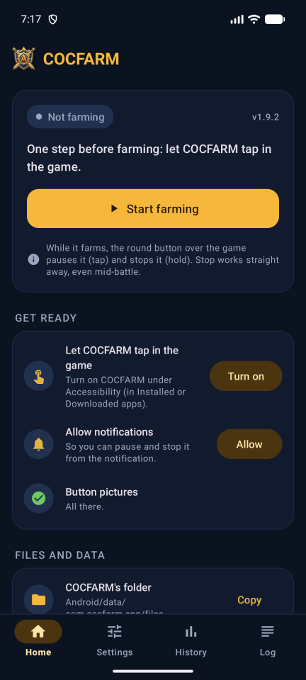
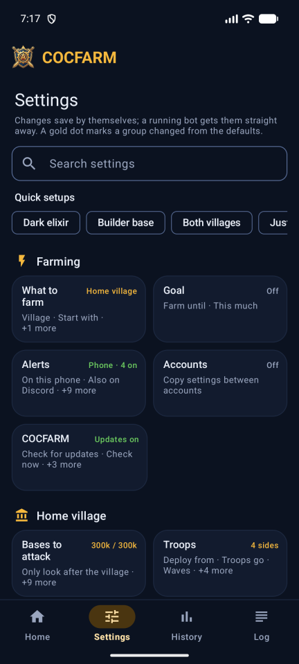
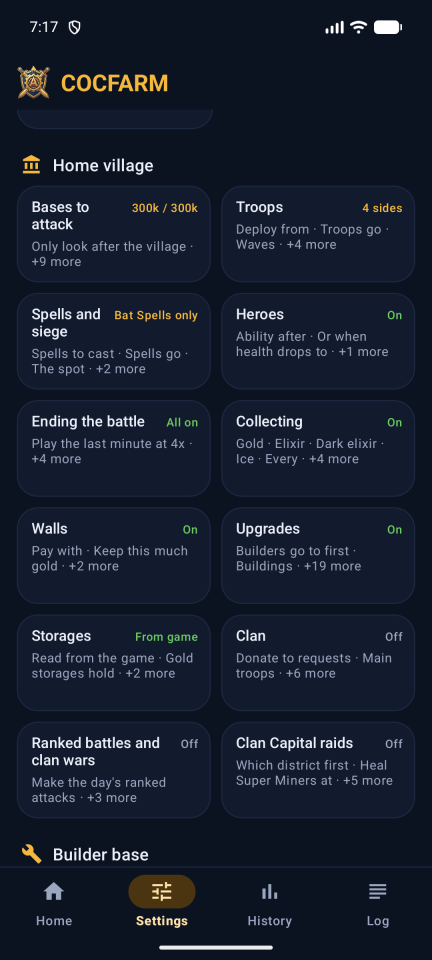
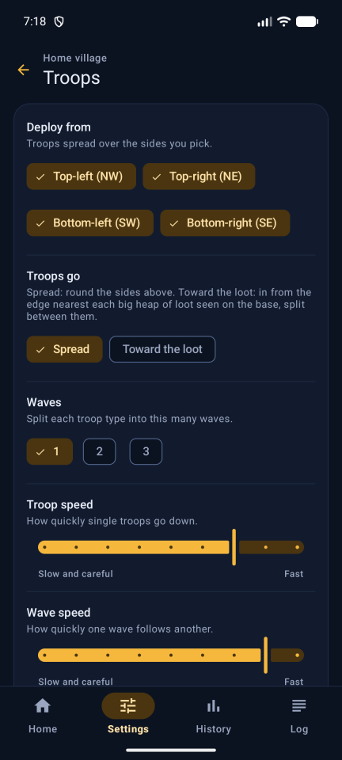
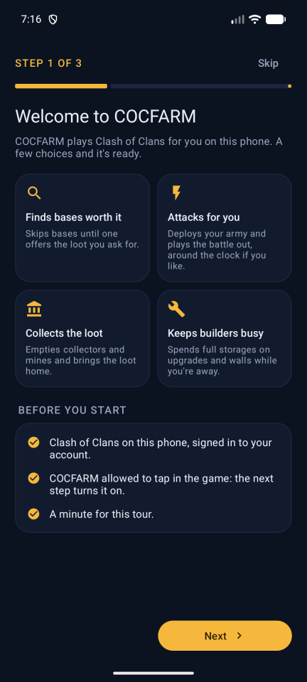
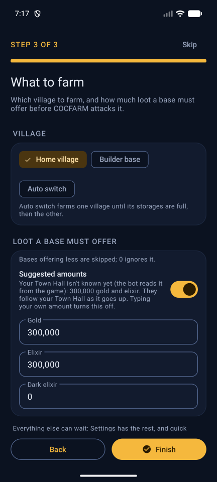

# COCFARM for Android

> [!NOTE]
> **Not affiliated with, endorsed by, or connected to Supercell.** Clash of Clans is a trademark of Supercell Oy.

**A Clash of Clans farming bot that runs on your phone.** COCFARM plays the game for you on
the same phone (or Android emulator) the game is on: it attacks, collects your loot and looks
after your village, in **both the home village and the builder base**. No PC needed.

**[⬇ Download the latest release](https://github.com/BilinP/COCFARM-Android/releases/latest)**

> [!WARNING]
> **Using this bot can get your Clash of Clans account banned.** Botting breaks
> Supercell's Terms of Service, and Supercell bans accounts it catches,
> temporarily or for good. Only use it on an account you're willing to lose.

## A quick look

<table>
  <tr>
    <td align="center"> <b>Home</b></td>
    <td align="center"> <b>Settings</b></td>
    <td align="center"> <b>Home village settings</b></td>
  </tr>
  <tr>
    <td align="center"> <b>How troops go in</b></td>
    <td align="center"> <b>Welcome tour</b></td>
    <td align="center"> <b>What to farm</b></td>
  </tr>
</table>

## What it does

**Farming**
- ⚔️ **Farms the home village.** It finds bases with the loot you want, sends out your troops, heroes and spells, fires the heroes' abilities, and comes home.
- 🎯 **Deploys at the red line.** Troops land just outside the red line, not out at the map's edge.
- 🏰 **Fits your Town Hall.** The loot a base must have follows suggested amounts for your Town Hall, or type your own.
- 📦 **Knows when to stop.** Stop when your storages are full, or set a farming goal and see how far along it is on Home.
- 🛠️ **Farms the builder base.** Both stages of builder battles, the hero's ability, the gem mine, the elixir cart and the Clock Tower's free boost.

**Looking after your village**
- 💰 **Collects everything**: resources, the loot cart and the builder base's extras.
- 🧱 **Spends spare loot.** Upgrades walls, buildings, heroes, research and pets in the order you pick, and never spends below the reserve you set. It never uses gems.
- 🤝 **Clan, war and Clan Capital (beta).** Donations, troop requests, war attacks and Raid Weekend raids are in Settings; they've had less testing on phones than farming.

**Running it**
- 📱 **A floating button over the game.** Tap it to pause, hold it to stop, straight away, even mid-battle.
- 🔋 **Looks after the phone.** It can pause when the battery is low, when the phone gets hot, or when it's unplugged.
- ⏰ **Plays when you want.** Pick the hours, a daily attack limit and random breaks.
- 🧑 **Plays like a person.** Varied taps, pauses, swipes and a battle rhythm of its own, each habit switchable.
- 🛟 **Recovers by itself.** If the game gets stuck, COCFARM restarts it and carries on.
- 📊 **Tracks your loot.** The History page shows every attack and what you gained.
- 🔔 **Alerts.** Notifications on the phone (no setup), plus Discord if you want them elsewhere.
- 💾 **Backs up your settings** to a file, and restores them on another phone.
- ⬆️ **Updates itself** from this repository's releases: it offers each new version on Home.

## Get started

You need **Android 7 or newer**, with Clash of Clans installed and signed in.
**Set the game to English** (Settings → Language): COCFARM finds its buttons by their English words.

1. On your phone, open the [latest release](https://github.com/BilinP/COCFARM-Android/releases/latest)
   and download **COCFARM-android-arm64.apk** (almost every phone).
   On an x86_64 emulator (LDPlayer, BlueStacks, MuMu), take **COCFARM-android-x86_64.apk**.
   Not sure? **COCFARM-android.apk** works on both, at twice the size.
2. Open the downloaded file. Android asks to allow installs from your browser: allow it once.
3. Open COCFARM. Its welcome tour sets up the basics.
4. When it asks, allow:
   - **Accessibility** (Settings → Accessibility → COCFARM): this is how it taps in the game.
     It only ever taps Clash of Clans.
   - **Notifications**: for the farming notification and your alerts.
   - **Screen sharing**: Android asks each time you press Start; COCFARM needs it to see the game.
5. Press **Start**. COCFARM opens the game and starts farming.

## Updates

COCFARM checks for a newer version by itself and shows it on Home: tap to download and install.
It only offers releases from this repository, built for Android, so it never offers the Windows app.

## The Windows app

COCFARM for Windows, which drives an Android emulator from a PC, is a separate app with its own
releases and updates: [BilinP/COCFARM](https://github.com/BilinP/COCFARM).

## Something went wrong?

On the **Log** page, tap **Copy report** and [open an issue](https://github.com/BilinP/COCFARM-Android/issues/new)
with it, your phone's model and Android version. The report leaves out player names and other
personal details.

## License

GPL-3.0: see [LICENSE](LICENSE). Third-party notices are in [THIRD_PARTY_NOTICES.txt](THIRD_PARTY_NOTICES.txt).
